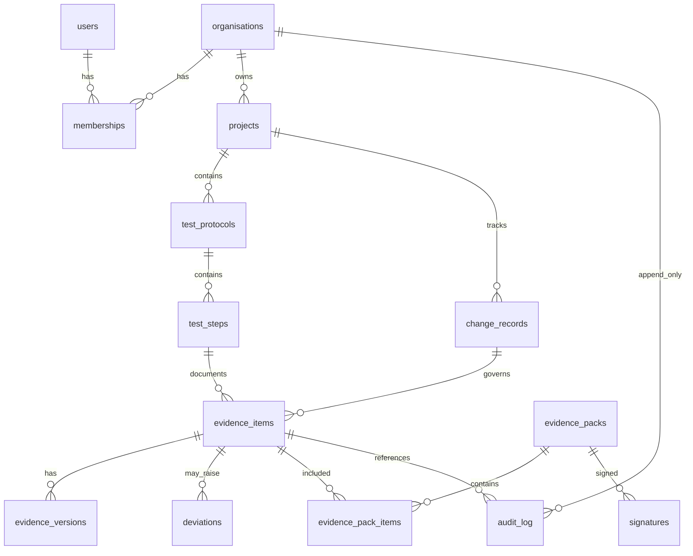

# SnapFlow GxP Evidence Backend — Design (DRAFT)

> **Status:** Design-only. **Not implemented.** No Supabase project has been provisioned from this repo.
>
> **Audience:** Luke Holmes, validation/QA pilot stakeholders.  
> **Regulatory framing:** 21 CFR Part 11, EU GMP Annex 11, ALCOA+ (Attributable, Legible, Contemporaneous, Original, Accurate + Complete, Consistent, Enduring, Available).  
> **Hosting target (planned):** Supabase **Free** tier, org *The Holmes Syndicate*, region **`eu-central-1`** (EU data residency preference).  
> **Desktop principle (unchanged):** Capture, OCR, PII detection, and local search remain **local-first** with **zero runtime dependency** on cloud; evidence sync is **opt-in** and tier-gated.

---

## 1. Domain model

### 1.1 Tenancy and identity

| Entity | Purpose |
|--------|---------|
| **Organisation (tenant)** | Legal/customer boundary; all RLS keys off `organisation_id`. |
| **User** | Human actor; linked to Supabase Auth `auth.users` (recommended) or mapped from custom IdP. |
| **Membership** | `(organisation_id, user_id, role)` — roles: `tester`, `reviewer`, `qa_approver`, `admin`. |
| **Audit identity** | Every cloud row stores `created_by_user_id` + server `created_at`; client-supplied user id is never trusted alone. |

### 1.2 Validation objects

| Entity | Purpose |
|--------|---------|
| **Project / system** | Validated system under test (e.g. LIMS module, MES screen flow). |
| **Test protocol (script)** | Versioned document: scope, GxP classification, linked SOP/training refs. |
| **Test step** | Ordered step within a protocol; expected result text; optional link to change record. |
| **Change record (CR)** | IT change ticket / CC number; gates which protocol version applies in a window. |

### 1.3 Evidence artefacts

| Entity | Purpose |
|--------|---------|
| **Evidence item** | One logical piece of proof: links **local capture id** (UUID), optional **step** and **CR**, metadata (tag, timestamps, hashes), and **blob refs**. |
| **Evidence version** | Immutable file generation: `original` (hash sealed at ingest), `processed` (annotations/focus-blur), `redacted` (PII masked) — each a new version row + storage object, never overwrite. |
| **Evidence pack** | Bundle for review/export: selected items + manifest hash + status (`draft` → `submitted` → `reviewed` → `approved`). |
| **Deviation / defect** | Non-conformance linked to step/item; workflow state; may reference evidence items. |
| **Review / approval** | Part 11-style signature records on pack or deviation; bound to content hash at sign time. |

### 1.2 ER diagram (logical)



---

## 2. Evidence integrity

| Control | Design |
|---------|--------|
| **Content hashing** | SHA-256 of each stored object (original and each derivative). Hash computed **server-side** on upload (stream hash); client may send `client_sha256` for mismatch detection only. |
| **Trusted time** | `recorded_at` = `now()` at ingest (Postgres `timestamptz`); `client_captured_at` stored separately, labelled non-authoritative. |
| **Attribution** | `created_by_user_id` from JWT; desktop local captures keep `local_user_ref` until sync binds to cloud user. |
| **Immutable originals** | `evidence_versions.kind = 'original'` — no UPDATE on blob path or hash; new processing → new version row. |
| **Redaction lineage** | `redacted` version `parent_version_id` → `original`; delivery/redacted desktop path mirrors this model. |
| **Audit hash chain** | Each `audit_log` row: `payload_hash`, `prev_hash`, `chain_hash = SHA256(prev_hash \|\| canonical_json(payload))`. Genesis row uses fixed `prev_hash = '0'`. |
| **Anchoring (optional, later)** | Daily Merkle root of `chain_hash` values stored off-box (e.g. object metadata, third-party timestamp service) for pilot+; not required for MVP demo. |

---

## 3. Append-only audit trail

**Table:** `audit_log` (organisation-scoped).

| Column | Notes |
|--------|------|
| `event_type` | e.g. `evidence.created`, `version.ingested`, `pack.submitted`, `signature.applied` |
| `entity_type` / `entity_id` | Pointer to business record |
| `actor_user_id` | Who |
| `reason` | **Why** (required for GxP corrections and manual overrides) |
| `metadata` | JSON (diff-safe, no PII blobs) |
| `prev_hash`, `chain_hash` | Integrity chain |

**Enforcement (Postgres):**

- `REVOKE UPDATE, DELETE` on `audit_log` from application roles.
- `BEFORE UPDATE OR DELETE` trigger → `RAISE EXCEPTION`.
- Inserts only via `SECURITY DEFINER` function `append_audit_event(...)` that computes chain fields.

**Corrections:** Never `UPDATE` business facts. Publish a **superseding** record (`supersedes_id`, `correction_reason`) and a new audit event. UI shows effective record as latest non-superseded.

Draft DDL patterns live in `docs/design/evidence-schema.draft.sql` (**not applied**).

---

## 4. Electronic signatures (Part 11 — pilot scope)

| Topic | Pilot MVP | Later |
|-------|-----------|-------|
| **Re-authentication** | Password / MFA step via Supabase Auth immediately before sign action | SSO + hardware key, step-up policies |
| **Meaning** | Enum: `author`, `review`, `approve` stored on `signatures` row | Configurable signature meanings per org SOP |
| **Manifest binding** | `signed_payload_hash` = SHA-256 of canonical pack manifest JSON at sign time | Full CFR11 compliant manifest + printed PDF embed |
| **Display** | Pack PDF footer: name, meaning, UTC time, hash short-id | Legally reviewed label text |
| **Non-repudiation** | Session + audit chain + hash; not qualified eIDAS | Legal review for EU QP sign-off |

Desktop **sign** action calls API → server records signature row + audit event; does not store signature bitmap in MVP.

---

## 5. Row Level Security, storage, URLs

### 5.1 RLS (Postgres)

- Enable RLS on all tenant tables.
- JWT claim `organisation_id` (set via custom claim or `memberships` lookup in policy).
- Policies:
  - **tester:** CRUD own draft evidence; read published protocols.
  - **reviewer:** read packs assigned; add review signatures.
  - **qa_approver:** approve packs; read audit.
  - **admin:** manage membership; no bypass of audit append-only.

Service role used only for **background jobs** (hash verify, export render), with narrow RPCs.

### 5.2 Storage layout (Supabase Storage)

```
evidence/
  {organisation_id}/
    {evidence_item_id}/
      {version_id}_original.png
      {version_id}_processed.png
      {version_id}_redacted.png
exports/
  {organisation_id}/
    {pack_id}/
      manifest.json
      evidence-pack.pdf
```

- **Private buckets**; no public ACL.
- Upload via **signed upload URL** (short TTL) or authenticated `storage.from().upload()` from desktop with user JWT.
- Download for reviewers: **signed download URL** (e.g. 15–60 minutes), logged in `audit_log`.
- Align with existing SnapFlow pattern: separate **share-link secret** for cross-system URLs if Node proxy remains (see §8).

### 5.3 Signed URL rules

- HMAC parameters: `exp`, `object_path`, `organisation_id`, optional `purpose=review|export`.
- Reject expired / tampered links; log access attempt (without blob body).

---

## 6. Retention, legal hold, export, verification

| Topic | Design |
|-------|--------|
| **Retention** | Org-level policy: default N years on `evidence_versions`; packs inherit. |
| **Legal hold** | `legal_hold` flag on organisation/project/item — blocks purge jobs. |
| **Export** | **PDF evidence pack** (human-readable) + **JSON/CSV manifest** (hashes, versions, signatures, audit excerpt). |
| **Verification tool** | CLI or admin UI: re-download objects, recompute SHA-256, compare manifest; verify audit chain from genesis. |
| **Purge** | Soft-delete metadata + storage lifecycle; prohibited when hold active; purge itself is an audit event. |

---

## 7. Sync model (desktop SQLite → cloud)

| Aspect | Rule |
|--------|------|
| **Queue** | Local `sync_outbox` table: payload idempotency key = `local_capture_id` + `operation` + `content_hash`. |
| **Offline** | Queue persists; retry with exponential backoff; no user blocking. |
| **Conflict** | **Last-write-wins on metadata** only for non-GxP fields (title, tag); **evidence versions are append-only** — never merge binary conflicts. |
| **Never leaves device (default)** | Full **OCR text** when PII flagged; **unredacted** images unless user explicitly opts in to cloud evidence upload for that item. |
| **What syncs when opted in** | Redacted/processed versions + hashes + minimal metadata; optional original only with explicit QA role + reason captured in audit. |
| **FTS5** | Stays local; cloud search uses Postgres `tsvector` on **non-PII** metadata fields only. |

Maps to existing desktop: cloud sync opt-in, `piiRedactedApplied`, `auth_sessions` bearer, refresh rotation.

---

## 8. API: Node `/v1` vs Supabase direct

| Approach | Pros | Cons |
|----------|------|------|
| **A. Supabase Auth + direct client** (PostgREST / Realtime / Storage SDK) | Fewer moving parts; RLS is source of truth; good for pilot dashboard later | Business rules in SQL/RPC; less reuse of existing Express deliver/AI routes |
| **B. Keep Node backend as BFF** | Reuse `auth_sessions`, deliver integrations, AI proxy, hash pipeline | Two auth systems unless unified; more ops |
| **C. Hybrid (recommended)** | Desktop → **Node BFF** for evidence ingest, signing, export, AI; **Supabase** for Postgres + Storage + Auth; RLS for future web reviewer UI | Slightly more design discipline |

**Recommendation:** **Hybrid (C)** for pilot.

- **Supabase Auth** as IdP (email/OAuth); org invites via `memberships`.
- Node exchanges Supabase JWT **or** continues **custom `auth_sessions`** with mapping table `user_auth_links(supabase_user_id, snapflow_account_id)` during transition.
- New routes (illustrative): `POST /v1/evidence/ingest`, `POST /v1/evidence/packs`, `POST /v1/evidence/sign`, `GET /v1/evidence/packs/:id/export`.
- Read-only reviewer UI (later) can use Supabase client + RLS directly.

---

## 9. Supabase Free tier (verified Nov 2025)

Sources: [Supabase pricing](https://supabase.com/pricing), [billing guide](https://supabase.com/docs/guides/platform/billing-on-supabase), [free project pausing](https://supabase.com/docs/guides/platform/free-project-pausing).

| Quota | Free tier (per active project) |
|-------|--------------------------------|
| Database size | **500 MB** |
| File storage | **1 GB** |
| Egress | **5 GB** / month (org-level aggregation) |
| MAU (Auth) | **50,000** |
| Active free projects | **2** per owner/admin (paused projects don’t count) |
| Pausing | Auto-pause after **~1 week** of low DB activity; restorable ~**1 year** |
| Max upload (single file) | **50 MB** |
| Backups / PITR | **Not** on Free |

**Pilot fit:** A small QA pilot (tens of users, hundreds of PNGs, metadata-heavy) fits if images are **redacted/compressed** and originals stay local by default. Risk: **1 GB storage** and **50 MB** upload cap — design evidence around **redacted** screenshots and chunked metadata sync.

**Likely paid triggers (flag only, no decision):** Storage > 1 GB, need **non-pausing** uptime, **PITR/backups**, SSO, >50 MB captures, or regulatory demand for dedicated compute/Enterprise BAA.

---

## 10. Phased delivery

### Phase 0 — Pilot MVP (credible demo)

1. Organisation + roles + one protocol with steps.  
2. Desktop: capture → PII redact → diff → attach to **step** + **CR**.  
3. Opt-in sync: upload **redacted** version only; server stores hash + trusted timestamp.  
4. Build **evidence pack** (draft); **reviewer** signature with re-auth.  
5. Export PDF + JSON manifest; run **verify** script on sample pack.

### Phase 1 — Hardening

Audit chain verification UI, legal hold, deviation workflow, anchoring, reviewer web app (Supabase + RLS).

### Phase 2 — Scale / compliance

Qualified validation package, SSO, automated regression evidence from CI, multi-site orgs.

---

## Open questions (for Luke)

1. **Qualified system boundary:** Is SnapFlow **Part 11 applicable** as a whole, or only the cloud evidence module in a larger validated stack?  
2. **Original vs redacted in cloud:** For pilot, is **redacted-only** upload acceptable to QA, or must originals reside in cloud under encryption?  
3. **Identity:** Google/GitHub OAuth vs corporate SSO (Azure AD) for first pharma pilot?  
4. **Signature wording:** Exact labels for `author` / `review` / `approve` per customer SOP?  
5. **CR linkage:** Mandatory CR on every evidence item, or only for production-like environments?  
6. **Retention default:** 2, 5, or 7 years; who sets per organisation?  
7. **Node BFF vs pure Supabase:** Confirm hybrid (C) or prefer single stack?  
8. **EU data:** Is `eu-central-1` sufficient, or customer-specific region / self-host requirement?  
9. **AI in GxP path:** Confirm **zero** cloud AI for evidence records (only local heuristics) unless explicit protocol allows?  
10. **Export format:** PDF template ownership — SnapFlow generic vs customer Word template merge?

---

## Related files

- Draft SQL (not applied): `docs/design/evidence-schema.draft.sql`
- Current architecture: `docs/ARCHITECTURE.md`
- Privacy / data flow: `docs/PRIVACY.md`
